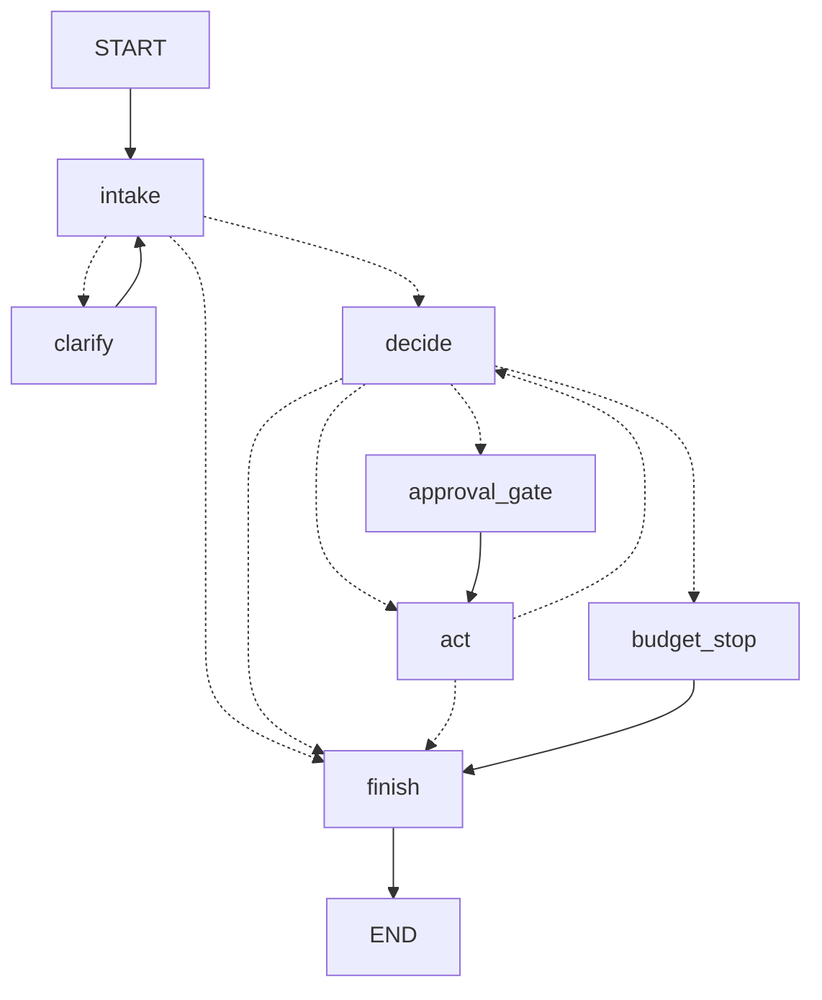

# InterviewPrep Agent – Milestones 1 & 2

**Authors:** Daria Zotova & Alina Lukyanov  
**Course:** AI Agents (סוכני בינה מלאכותית), Department of Information Systems, Max Stern Yezreel Valley College  
**Semester:** Fall 2026 (סמסטר א' תשפ"ז)  
**Target Domain:** Junior DevOps / Python Developer  

**Milestone 2 (LangGraph):** [](https://colab.research.google.com/github/AlinaLu22/interview-prep-agent/blob/main/interview_prep_milestone2.ipynb)  
**Milestone 1 (agent loop):** [](https://colab.research.google.com/github/AlinaLu22/interview-prep-agent/blob/main/interview_prep_milestone1.ipynb)


---

## Overview

**InterviewPrep Agent** helps junior DevOps / Python candidates prepare for technical and behavioral job interviews. It compares a resume with a job posting, computes skill gaps, retrieves relevant questions from a curated question bank, verifies them (no discriminatory topics, grounded in the resume/vacancy) and saves the question set only after the user approves it.

This repository contains **Milestone 1** (tool contracts, state, agent loop) and **Milestone 2** (the same agent orchestrated as a LangGraph `StateGraph`: conditional edges, model-tools loop, step budget, `interrupt` + resume, checkpointer with `thread_id`). Milestone 1 implements: tool contracts, validation and permissions, timeout and retries, explicit state, memory isolation, full-vs-reduced context comparison, and an agent loop with traces.

The agent loop is driven by a model that chooses the next tool:

| Mode | Model | When |
| :--- | :--- | :--- |
| default | `MockLLM` – **mock model** (explicitly marked, deterministic, no API key, no cost) | tests, trace files, notebook without a key |
| live | `GeminiLLM` – Google Gemini via function calling; `parse_resume`/`parse_vacancy` extract with Gemini JSON output | when `GEMINI_API_KEY` is set (environment variable or Colab Secrets) |

Step budget: 14 (tool calls including retries, plus the model's final decision). The regular scenario of the proposal takes 10 steps.

---

## Milestone 2 – LangGraph orchestration

The logic of Milestone 1 / lesson 4 (`src/agent.py`, kept unchanged for comparison) is converted to a graph in **`src/graph.py`**. The tools, the model layer (mock or Gemini), the two-layer question filter and the memory are reused from Milestone 1, not copied.



The exact diagram generated from the compiled graph is in `docs/graph.mmd` (and in `docs/milestone2.md`).

**Four routes, each with an automated test and a trace file** (`docs/traces/trace_graph_*.jsonl`):

| # | Route | Result |
| :-: | :--- | :--- |
| 1 | existing data | `DONE`, 10 steps, 10 grounded questions, plan saved after approval |
| 2 | missing information | the graph stops at `interrupt()` in `clarify`, asks, and is resumed with `Command(resume=...)` (even by a new graph object, because the state is in the checkpointer) |
| 3 | transient failure | mock 503 in `search_question_bank` -> retry -> `DONE` (11 steps); two failures -> controlled end `tool_failed` |
| 4 | step budget used up | `max_steps=3` -> `stopped_step_budget`, nothing saved |

Plus the **checkpointer demo**: one checkpointer, two `thread_id`s - thread A is stopped and later resumed while thread B runs to the end; the states never mix (`docs/traces/trace_graph_checkpointer_two_threads.jsonl`).

```bash
pytest -v                 # all tests (Milestone 1 + 2), mock model, no key
python -m src.graph       # regenerates docs/traces/trace_graph_*.jsonl and docs/graph.mmd
python -m src.graph --live   # one run through the graph with Gemini (needs GEMINI_API_KEY)
```

Documentation: `docs/milestone2.md` (graph, state and reducers, routes, traces, comparison with lesson 4, limitations), `docs/progress_report.md` (progress report) and `docs/ai_usage.md` (AI usage appendix). LangGraph is pinned to the exact version in `requirements.txt`. The notebook `interview_prep_milestone2.ipynb` clones the repo, installs the requirements, runs the tests and the four routes with traces and the checkpointer demo (mock model by default; Gemini when `GEMINI_API_KEY` is set in Colab Secrets).

---

## Repository Structure

```text
.
├── README.md
├── requirements.txt                  # exact versions
├── pytest.ini                        # lets `pytest` find the src package
├── interview_prep_milestone1.ipynb   # Google Colab notebook, Milestone 1
├── interview_prep_milestone2.ipynb   # Google Colab notebook, Milestone 2 (LangGraph)
├── src/
│   ├── __init__.py
│   ├── tools.py      # 5 tools, contracts (JSON schemas), extraction check, filter, run_tool (timeout, retries)
│   ├── state.py      # AgentState, ThreadStore, NoteStore, build_context, context comparison
│   ├── llm.py        # MockLLM (mock model), GeminiLLM + GeminiExtractor (real model), make_llm()
│   ├── agent.py      # lesson 4 / Milestone 1 loop (kept for comparison), approval gate, stop conditions
│   └── graph.py      # Milestone 2: LangGraph StateGraph, state + reducers, routes, trace generation
├── tests/
│   ├── __init__.py
│   ├── test_tools.py   # valid / invalid / transient for every tool + timeout, permissions, extraction, filter
│   ├── test_state.py   # state, step budget, thread & memory isolation, context comparison
│   ├── test_agent.py   # loop, stop conditions, approval gate, two conversations do not mix
│   ├── test_llm.py     # Gemini agent + extractor with a fake client (no network)
│   └── test_graph.py   # Milestone 2: four routes, interrupt/resume, checkpointer threads, approval gate, reducers
├── data/
│   ├── question_bank.json            # synthetic interview question bank
│   └── filter_test_questions.json    # 20 indirect forbidden + 10 legitimate questions (filter test)
└── docs/
    ├── milestone1.md                 # documentation, Milestone 1 (max 2 pages)
    ├── milestone2.md                 # documentation, Milestone 2 (graph diagram, routes, comparison with lesson 4)
    ├── progress_report.md            # Milestone 2 progress report
    ├── graph.mmd                     # Mermaid diagram generated from the compiled graph
    ├── ai_usage.md                   # AI usage appendix (Milestone 1 + Milestone 2)
    └── traces/
        ├── trace_normal.jsonl        # Milestone 1: normal run
        ├── trace_transient.jsonl     # Milestone 1: transient failure that is retried
        └── trace_graph_*.jsonl       # Milestone 2: one file per route + the checkpointer demo
```

---

## Installation & Running

### 1. Setup (Python 3.11+; checked on 3.12 and on 3.13, the version Google Colab uses)
```bash
git clone https://github.com/AlinaLu22/interview-prep-agent.git
cd interview-prep-agent
pip install -r requirements.txt
```

### 2. Run all tests (one command, mock model, no API key, no external service)
```bash
pytest -v
```

### 3. Generate the trace files (mock model)
```bash
python -m src.agent
```
Writes `docs/traces/trace_normal.jsonl` and `docs/traces/trace_transient.jsonl`.

### 4. Run one conversation with the real model (optional)
```bash
export GEMINI_API_KEY="..."          # never commit the key
export GEMINI_MODEL="gemini-3.5-flash" # optional; without it the newest available Flash model is used
python -m src.agent --live
```

### 5. Google Colab
Open the notebook of the milestone with the badge above and choose **Runtime → Run all**. The first cell clones the repository and installs `requirements.txt`. Without a key everything runs with the mock model. To use Gemini, add a secret named `GEMINI_API_KEY` in **Colab Secrets** and enable **Notebook access**.

---

## Security & Privacy Notice
* Only synthetic resumes, synthetic job postings and curated interview questions are included.
* The API key is read only from the environment or Colab Secrets; it is not stored in the repository.
* `save_prep_plan` writes only inside `prep_plans/` (ignored by git) and only after user approval.
