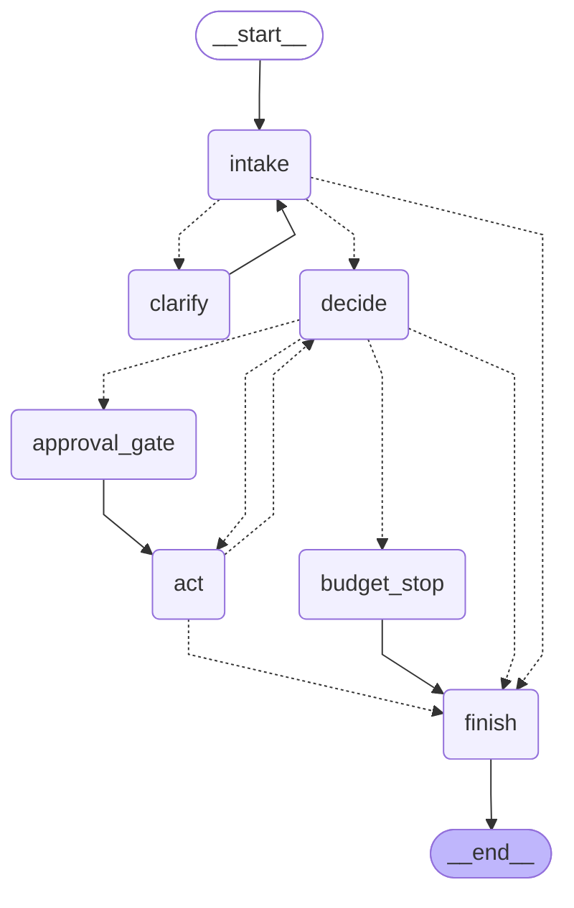

# מסמך תיעוד – אבן דרך 2 (Milestone 2): תזמור ב-LangGraph
**פרויקט:** InterviewPrep Agent – סוכן AI להכנה לראיונות עבודה (Junior DevOps / Python)  
**מגישות:** דריה זוטובה ואלינה לוקיאנוב  
**קורס:** סוכני בינה מלאכותית | המכללה האקדמית עמק יזרעאל | סמסטר א' תשפ"ז  

הלוגיקה של אבן דרך 1 ושל שיעור 4 (המודל מחליט, הקוד מאמת ומריץ, המצב מתעדכן) הומרה לגרף `StateGraph` ב-`src/graph.py`. הכלים, שכבת המודל (`MockLLM` – מודל מדומה ומסומן כך; `GeminiLLM`), המסנן הדו-שכבתי והזיכרון **נשארו ללא שינוי** ומשמשים את הגרף ישירות מ-`src/tools.py`, `src/llm.py` ו-`src/state.py`.

## 1. הגרף
התרשים נוצר אוטומטית מהגרף המקומפל (`python -m src.graph` ← `docs/graph.mmd`), ובדיקה מוודאת שהוא זהה לגרף בקוד. קשתות מקווקוות הן קשתות מותנות.

| צומת | תפקיד | מה הוא עושה |
| :--- | :--- | :--- |
| `intake` | קלט | בודק שקורות החיים והמודעה קיימים (לפחות 15 תווים, כמו סכמת הכלים) ורושם אירוע קלט |
| `clarify` | הבהרה | `interrupt()` – עצירה אמיתית ושאלה למשתמש; אחרי `Command(resume=...)` מעדכן את הקלט וחוזר ל-`intake` |
| `decide` | החלטת המודל | בודק תקציב צעדים (המקום היחיד שבו הוא נבדק), בונה הקשר (`build_context`) והמודל בוחר את הכלי הבא או מסיים |
| `approval_gate` | אישור משתמש | לפני `save_prep_plan`: תשובת המשתמש (דגל בקלט או `interrupt`). `approved` נקבע רק מ-`True` אמיתי, אף פעם לא מהמודל |
| `act` | ביצוע | `run_tool` (אימות, הרשאות, מגבלת זמן, ניסיון חוזר), עדכון המצב והסינון הדו-שכבתי של כל שאלה |
| `budget_stop` | עצירה מבוקרת | רושם שהתקציב נגמר ומעביר ל-`finish` |
| `finish` | סיום | מרכיב תשובה, כותב זיכרון ארוך-טווח רק לתוכנית שאושרה ונשמרה, ומוחק את הטקסט הגולמי מהמצב |

**לולאת מודל–כלים:** `decide` ← `act` ← `decide`. המודל מחליט, `act` מבצע, והתצפית חוזרת למצב. בתרחיש הרגיל: 10 החלטות, 9 ביצועים ואישור אחד.

| קשת מותנית | תנאי |
| :--- | :--- |
| `intake` ← `clarify` / `decide` / `finish` | קלט חסר / הכול קיים / אחרי שני סבבי הבהרה בלי תשובה תקינה |
| `decide` ← `act` / `approval_gate` / `budget_stop` / `finish` | כלי רגיל / `save_prep_plan` / `step >= max_steps` / המודל סיים |
| `act` ← `decide` / `finish` | המשך הלולאה / כשל זמני שלא חלף או חילוץ שנכשל |

**תנאי סיום:** המודל מסיים; תקציב 14 צעדים (כמו באבן דרך 1: קריאה לכלי, ניסיון חוזר או החלטת מודל); קלט חסר שלא הושלם; כשל זמני שלא חלף.

## 2. המצב ו-Reducers (`GraphState`, ‏`TypedDict`)
| שדות | מדיניות | נימוק |
| :--- | :--- | :--- |
| `searched_skills`, `tool_log`, `messages`, `trace_events` | `operator.add` | יומנים שרק גדלים: כל צומת מחזיר רק את החדש, ואין העתקה ידנית של הרשימה |
| `candidate_questions` | `merge_questions` (Reducer מותאם) | מוסיף שאלות חדשות, מסיר כפילויות לפי `doc_id` ולא עובר 12 שאלות, גם אם צומת יחזיר יותר |
| `step`, `max_steps`, `retry_count`, `clarify_rounds`, `next_action`, `stop_reason`, `status`, `answer` | דריסה | ערך נוכחי בלבד |
| `resume_json`, `vacancy_json`, `gap_json`, `saved_plan_path` | דריסה | תוצאות הכלים |
| `user_approval`, `approved` | דריסה | `user_approval` הוא תשובת המשתמש; `approved` נגזר ממנה בקוד |
| `resume_text`, `vacancy_text` | דריסה | קלט הריצה; נמחק ב-`finish` |

כל שיחה היא `thread_id` אחד ב-checkpointer, ולכן אין צורך ב-`ThreadStore` של אבן דרך 1. בדיקת הבעלות על השיחה (`PermissionError` למשתמש אחר) נשמרה ב-`stream_run`.

## 3. ארבעה מסלולים מוכחים
| # | מסלול | בדיקה אוטומטית | קובץ עקבות | תוצאה בהרצה |
| :-: | :--- | :--- | :--- | :--- |
| 1 | נתונים קיימים | `test_route1_existing_data_success`, ‏`test_graph_matches_the_lesson4_loop` | `trace_graph_route1_existing_data.jsonl` | `DONE`, 10 צעדים, 10 שאלות מבוססות, התוכנית נשמרה |
| 2 | מידע חסר: עצירה, בקשת הבהרה והמשך | `test_route2_missing_info_stops_at_interrupt_and_resumes_with_a_new_graph_object` ועוד שתיים (תשובת מילון, הבהרה שלא נענתה) | `trace_graph_route2_missing_info_interrupt.jsonl` | עצירה ב-`clarify` בלי אף קריאה לכלי; חידוש עם **אובייקט גרף חדש**; `DONE`, 10 צעדים |
| 3 | כשל זמני | `test_route3_transient_failure_is_retried_and_then_succeeds`, ‏`test_route3_persistent_failure_ends_in_a_controlled_way`, ‏`test_a_retry_never_exceeds_the_remaining_budget` | `trace_graph_route3_transient_retry.jsonl` | כשל אחד ← ניסיון חוזר (`attempts=2`) ← `DONE`, 11 צעדים; שני כשלים ← `tool_failed`, לא נשמר דבר |
| 4 | מיצוי תקציב הצעדים | `test_route4_step_budget_exhaustion_stops_the_run` | `trace_graph_route4_step_budget.jsonl` | `max_steps=3` ← `stopped_step_budget` אחרי 3 צעדים, לא נשמר דבר |

הכשל בכלי החיפוש הוא **כשל מדומה (MOCK)** שמוזרק על ידי `flaky_tool` בבדיקות ובהפקת העקבות בלבד, ואינו חלק מהסוכן. כל הבדיקות רצות עם מודל מדומה, בלי מפתח ובלי עלות, בפקודה אחת: `pytest`.

## 4. עקבות ושמירת מצב (checkpointer)
קובצי העקבות ב-`docs/traces/` נוצרים מ-`graph.stream(..., stream_mode="updates")`. לכל צומת שרץ יש שורה `node` עם השדות שהוא שינה, ואחריה האירועים שלו: `decision` (מה המודל החליט), `tool_call` (כולל `attempts` ו-`retries`), `approval_gate`, `budget_stop`, `done`. עצירה נרשמת מה-checkpoint האמיתי (`paused_at_interrupt`, ‏`checkpoint`) ואחריה `resume`. בדיקה (`test_committed_graph_traces_are_what_the_code_produces`) מריצה את הקוד מחדש ומוודאת שהקבצים שבמאגר זהים לפלט שלו, כך שאי אפשר להגיש עקבות שלא נוצרו מהקוד.

**הדגמת `thread_id`** (`trace_graph_checkpointer_two_threads.jsonl`, ‏`test_two_threads_on_one_checkpointer_do_not_mix`): checkpointer אחד ושתי שיחות. שיחה A נעצרת ב-`clarify`; בזמן העצירה שיחה B רצה עד הסוף (`DONE`) ושיחה A לא משתנה (`thread_A_gap = null`); אחר כך A מחודשת ומסתיימת. הפערים של השיחות שונים (A: חסרים docker ו-CI/CD; B: חסר linux), ביומן הכלים של כל שיחה הצעדים רצופים (1..9 ו-1..10), ולכל אחת 26 נקודות שמירה (`get_state_history`).

## 5. השוואה למימוש משיעור 4
המימוש משיעור 4 (לולאת `while` ב-`src/agent.py`) נשאר במאגר לשם השוואה ולא הועבר, כדי לא לשבור את המחברת של אבן דרך 1. בדיקה (`test_graph_matches_the_lesson4_loop`) מוכיחה שההמרה לא שינתה את ההתנהגות: אותו פער, אותן שאלות, אותו סדר כלים ואותם 10 צעדים.

**מה השתנה:** ה-`if/break` של הלולאה הפך לקשתות מותנות; `AgentState` (pydantic, עדכון ידני עם `model_copy`) הפך ל-`TypedDict` עם Reducers שבו כל צומת מחזיר רק את השינוי; שאלת ההבהרה, שבלולאה הייתה עצירה סופית (`clarification_needed`), הפכה ל-`interrupt` אמיתי עם חידוש; `ThreadStore` הוחלף ב-checkpointer לפי `thread_id`; רשימת העקבות הידנית הוחלפה בפלט `stream`.

**מה התפשט:** תנאי העצירה גלויים כקשתות בתרשים במקום להיות קבורים בקוד הלולאה; עצירה וחידוש ובידוד בין שיחות מגיעים מה-checkpointer בלי קוד נוסף; בדיקת התקציב נמצאת במקום אחד.

**מה התעקב:** יותר קוד שלד (סכמת מצב, שבעה צמתים, פונקציות ניתוב ומפת קשתות); המצב מוגדר פעמיים (`GraphState` וגם התצוגה `AgentState` שבה משתמשים העוזרים מאבן דרך 1, דרך המתאם `_agent_state`); כל קריאה לכלי עולה 2–3 צעדי גרף, ולכן נדרש להעלות את `recursion_limit` ל-100 ויש בנוסף את תקציב הצעדים שלנו; בחידוש LangGraph מריץ את הצומת מההתחלה, כך שקוד לפני `interrupt()` חייב להיות בלי תופעות לוואי; ניפוי שגיאות קשה יותר כי הלוגיקה פרוסה על פני צמתים.

## 6. מגבלות ידועות
* הרצת הגרף עם Gemini אמיתי טרם נבדקה בפועל (הבדיקות והעקבות הן עם `MockLLM`); Gemini נבדק רק מול לקוח מדומה (בבדיקות של אבן דרך 1).
* `InMemorySaver` מאבד את המצב כשהתהליך נגמר; בפרויקט אמיתי נדרש checkpointer מתמיד.
* הטקסט הגולמי נמחק מהמצב הנוכחי ב-`finish`, אבל נקודות שמירה קודמות ב-checkpointer עדיין מכילות אותו.
* האישור לפני שמירה מדומה כברירת מחדל על ידי דגל בקלט; גרסת ה-`interrupt` האמיתית נבדקת בנפרד ועדיין לא חלק מהמחברת.
* חוט שחרג מהזמן אינו נעצר (מגבלה קיימת מאבן דרך 1); בנק של 15 שאלות; המאגרים בזיכרון.
* גרסת LangGraph (`1.2.24`) נבחרה ונבדקה על ידינו; יש לוודא שהיא זהה לגרסה שמפורסמת באתר הקורס.

## 7. שחזור
`git clone` ← `pip install -r requirements.txt` ← `pytest` ← `python -m src.graph` (מפיק מחדש את העקבות והתרשים). פירוט והקישור למחברת ב-`README.md`.
